<picture>
  <source media="(prefers-color-scheme: dark)" srcset="https://raw.githubusercontent.com/itu-itis23-baranr22/itu-itis23-baranr22/main/assets/banner-dark.svg">
  <source media="(prefers-color-scheme: light)" srcset="https://raw.githubusercontent.com/itu-itis23-baranr22/itu-itis23-baranr22/main/assets/banner-light.svg">
  
</picture>

I'm a 4th-year Computer Engineering student at Istanbul Technical University. I'm interested in AI/ML, computer vision and systems programming.

I'm open to long-term internships: [baranr22@itu.edu.tr](mailto:baranr22@itu.edu.tr)

### Selected work

**[wiki-rag](https://github.com/itu-itis23-baranr22/wiki-rag)** ·
[Live demo](https://itu-itis23-baranr22.github.io/wiki-rag/) 
Answers questions about Wikipedia pages using models that run
entirely on your own machine. Each sentence in an answer is
highlighted together with the source sentence behind it, and it
says so when the pages don't contain the answer. Built with hybrid
vector and keyword search on FastAPI, ChromaDB and Ollama, and
evaluated on a fixed set of 112 questions.

**[crawler](https://github.com/itu-itis23-baranr22/crawler)** 
A search engine that runs on your own machine, with the crawler and
BM25 index written from scratch in Python. It obeys robots.txt and
per-site speed limits, and a live map shows every address it reached
and why each one was indexed, skipped or failed. Several crawls run
at once without losing data, and an interrupted crawl resumes where
it stopped.

**[MiniGames](https://github.com/itu-itis23-baranr22/MiniGames)** ·
[Play in your browser](https://itu-itis23-baranr22.github.io/MiniGames/) 
Six classic-style games built with Flutter, each with a twist. In
Sonsuz XOX your oldest piece disappears when you place a fourth, and
in Dönen Dörtlü the board rotates every five moves. Runs on web and
Android, with interactive tutorials and CPU opponents at three
difficulty levels.

### Tools

<picture>
  <source media="(prefers-color-scheme: dark)" srcset="https://raw.githubusercontent.com/itu-itis23-baranr22/itu-itis23-baranr22/output/snake-dark.svg">
  <source media="(prefers-color-scheme: light)" srcset="https://raw.githubusercontent.com/itu-itis23-baranr22/itu-itis23-baranr22/output/snake-light.svg">
  
</picture>
